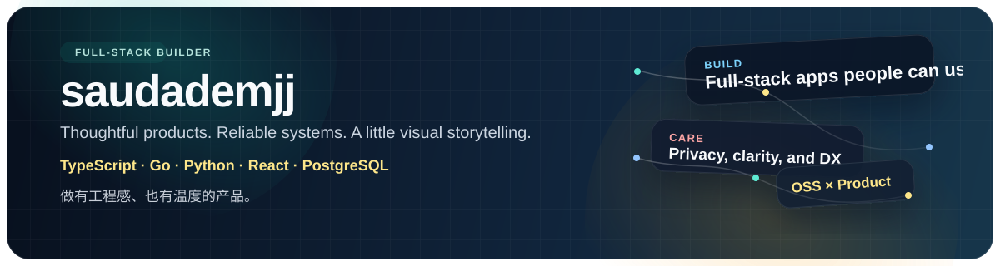

  

  

    
    
    
  

  

    Thoughtful full-stack products, privacy-minded systems, and interfaces with a little personality.
  

  

    我喜欢把产品做得有温度，把系统做得更稳，也愿意认真打磨体验与文档。
  

## About Me

- Building across `TypeScript`, `Go`, and `Python`, from frontend interaction to backend architecture.
- Product-minded by default: I enjoy turning messy ideas into tools people can actually use.
- Especially interested in secure systems, AI-assisted workflows, and polished web experiences.
- Often exploring open-source projects to learn engineering patterns worth borrowing.

## Selected Work

<table>
  <tr>
    <td width="50%" valign="top">
      <h3><a href="https://github.com/saudademjj/fitness-food">fitness-food</a></h3>
      
An AI nutrition tracker that parses natural-language meals into a 23-dimension nutrition profile.

      
<strong>Stack:</strong> Next.js 15, React 19, TypeScript, PostgreSQL, Gemini

    </td>
    <td width="50%" valign="top">
      <h3><a href="https://github.com/saudademjj/message">message</a></h3>
      
An end-to-end encrypted chat app with a zero-knowledge relay, real-time messaging, and client-side crypto.

      
<strong>Stack:</strong> Go, React 19, WebSocket, PostgreSQL, Web Crypto API

    </td>
  </tr>
  <tr>
    <td width="50%" valign="top">
      <h3><a href="https://github.com/saudademjj/Lovejournal-New">Lovejournal-New</a></h3>
      
A memory journaling app that combines timelines, maps, photos, and location-aware storytelling.

      
<strong>Stack:</strong> FastAPI, React, PostgreSQL, async SQLAlchemy

    </td>
    <td width="50%" valign="top">
      <h3><a href="https://github.com/saudademjj/drizzle-migration-guard">drizzle-migration-guard</a></h3>
      
A GitHub Action that explains Drizzle migration collisions directly inside pull requests.

      
<strong>Stack:</strong> TypeScript, GitHub Actions, Drizzle workflow tooling

    </td>
  </tr>
</table>

## What I Like Building

- Full-stack products with modern TypeScript tooling and clean database design
- Secure or privacy-sensitive features that need careful engineering, not just UI polish
- AI features that stay practical and cost-aware instead of becoming gimmicks
- Interfaces with motion, structure, and a strong sense of narrative

## Toolbox

  
  
  
  
  
  
  
  
  
  
  

## Also Worth A Look

- [library](https://github.com/saudademjj/library): seat reservation system with QR check-in and admin workflows
- [bookshelf](https://github.com/saudademjj/bookshelf): lightweight Bun + Hono + Drizzle backend for book management
- [saudademjj.github.io](https://github.com/saudademjj/saudademjj.github.io): a cinematic GitHub Pages experiment built with plain HTML, CSS, JS, and GSAP

## Open Source Interests

I keep a close eye on developer tooling, frontend systems, docs infrastructure, and practical OSS that solves real workflow problems. Recent areas I have explored include changelog tooling, feature flags, form systems, API tooling, package management, and infra-oriented platforms.

  Thanks for stopping by. If one of these projects resonates with you, feel free to explore the repos.

<!-- profile-refresh: 2026-03-22 -->
